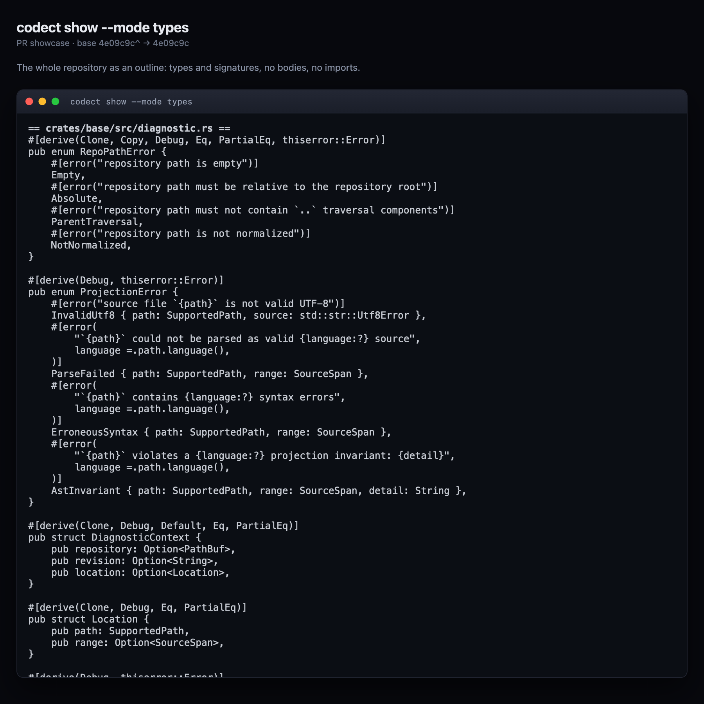
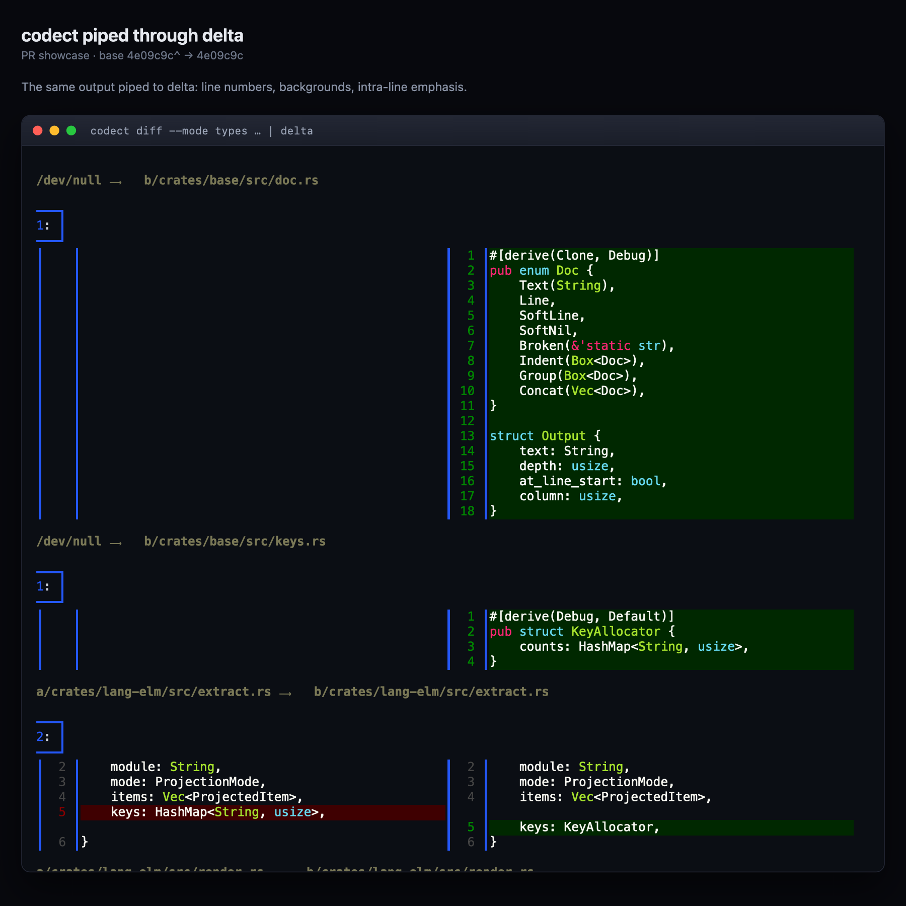
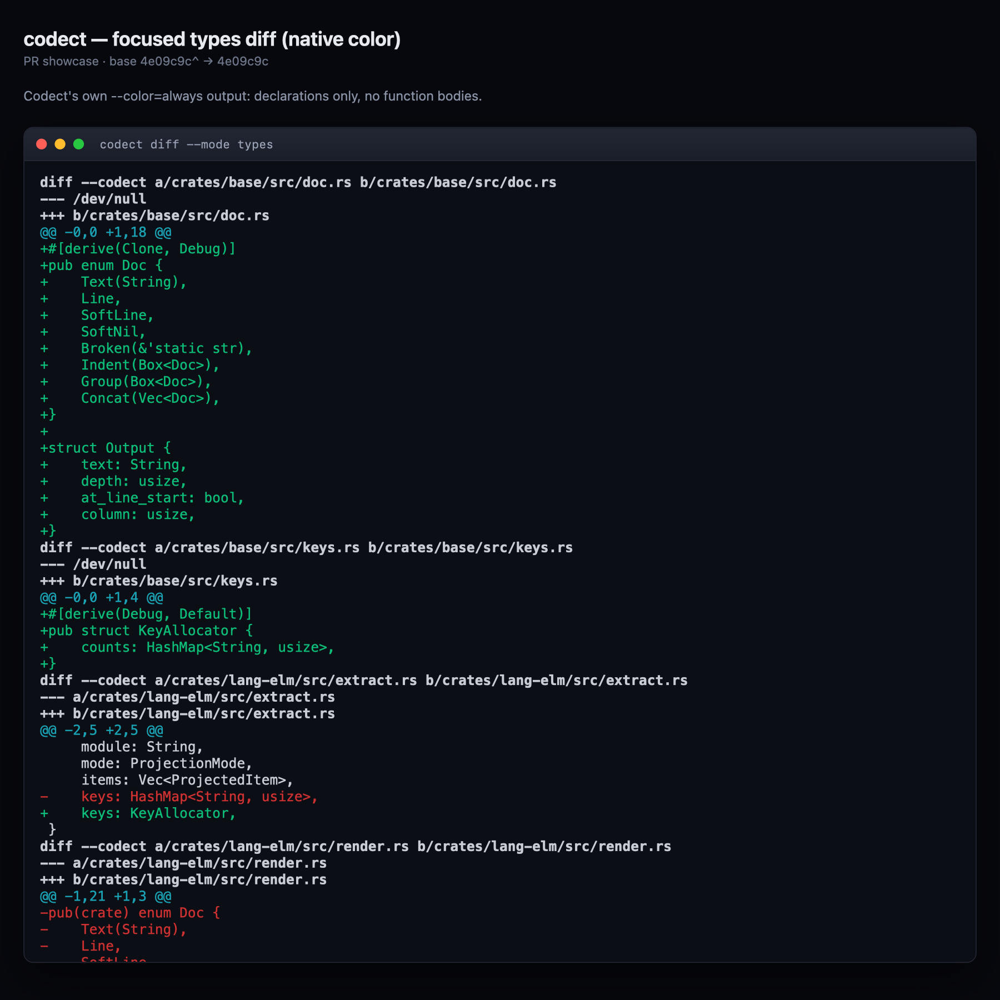

# Using the CLI

Codect provides selectable views of a codebase at different levels of detail.
Its focused views remove implementation bodies so you can study the shape of the
code without reading how it works. `PRODUCT.md` is authoritative for behavior
and scope.

## Commands

```text
codect show --format <text|json> --mode <types|signatures|tests> [--path <PATH> | --area <AREA>]... [REVISION]
codect show --format json --mode <types|signatures|tests> --stdin    --path <FILE>
codect show --format json --mode <types|signatures|tests> --worktree --path <FILE>
codect diff --format <text|json> --mode <types|signatures|tests> [--merge-base] [--path <PATH> | --area <AREA>]... <BASE> <TARGET>
```

- `show` with an omitted `REVISION` projects supported files on disk (Git-independent); an explicit `REVISION` requires Git.
- `--mode` is required. `types` shows type declarations; `signatures` adds every
  named function, method, and value signature; `tests` is the Signatures
  projection restricted to tests in Rust and Python. Function bodies are never
  shown.
- `--format` defaults to `text`, the canonical projection. `--format json` emits
  the versioned documents described below.
- `diff` takes two independent revisions (not a range). Both text and JSON diff
  also accept the snapshots `:index`, `:worktree`, `:empty`, and the canonical
  Git empty-tree object ID.
- `diff --merge-base` compares the merge base of `<BASE>` and `<TARGET>` against
  `<TARGET>` (`git diff BASE...TARGET`), so commits that only landed on `<BASE>`
  after the branches diverged do not appear. Both sides must be commits.
- `--color <auto|always|never>` defaults to `auto`; redirected output never
  contains escape bytes.

Examples:

```sh
codect show --mode types
codect show --mode signatures --path src/auth.rs
codect show --mode signatures --area frontend
codect diff --mode types HEAD~1 HEAD
codect diff --format json --mode types HEAD :index       # staged changes
codect diff --format json --mode types :index :worktree  # unstaged changes
codect diff --mode types --merge-base main feature       # feature since its branch point
```

`show` renders the whole repository as an outline:



*`codect show --mode types` — every type declaration, no bodies, no imports.*

## Path scoping

`--path`/`-p` is repeatable and narrows a command to a file or directory (a
directory includes everything beneath it). A path that names nothing in the
projected revision — or in either side of a diff — is an error. A path that
exists but contains no supported files is valid and produces empty output.

Paths are relative to the current directory and must stay inside the root (the
repository worktree when inside Git, otherwise the current directory).
Resolution is lexical: `.`, repeated slashes, and trailing slashes are
normalized, and `..` may climb but may not leave the root. Matching is
byte-exact and respects path boundaries, so `src` does not match `src2/lib.rs`.
## Named areas

`--area`/`-a` is repeatable and selects named path groups defined in
`.codect.toml` at the repository root. Area paths are relative to the repository
root and are read only when `--area` is used. `--area` and `--path` cannot be
combined.

```toml
[areas]
frontend = ["apps/web", "packages/ui"]
backend  = ["services/api"]
```

An area is satisfied when any one of its paths names something in the projected
revision, or in either side of a diff. A missing or malformed config, or an area
name the config does not define, is an error. Areas are declarative data: names
and literal paths only, no globs, no substitutions.

## Focused diffs

A focused diff renders a comparison of the selected projections of two
snapshots; it never renders complete source text. File-move detection may read
source bytes solely to pair old and new paths. Implementation-only changes are
intentionally invisible:
if a function body changes while its projected declaration is unchanged, the
focused diff shows no change for that function. Files with equal projections are
omitted, so an empty result means there are no focused changes. The exception is
a detected **file move**. Codect pairs a removed supported path
with an added supported path of the same language, first by exact source content
and then by a fixed source-content similarity threshold. Detection runs over the
complete snapshots before path or area filtering, so a narrow scope cannot change
the pairing. A move with at least one nonempty projection is emitted even when
its two projections are equal: a body-only edit inside a move produces no hunks,
but the move remains visible. A move whose two requested-mode projections are
both empty is omitted. Selecting either the
old or the new path returns the whole move. There is no user-facing similarity
threshold, and detection does not depend on Git rename configuration.

A pure move renders like Git's rename display, with no content headers or hunks:

```text
diff --codect a/src/old.rs b/src/new.rs
rename from src/old.rs
rename to src/new.rs
```

An edited move follows the two `rename` lines with `--- a/src/old.rs`,
`+++ b/src/new.rs`, and ordinary focused hunks.

`:index` reads stage-zero blob bytes. `:worktree` reads tracked regular files on
disk plus untracked, non-ignored files, and does not follow symlinks; it never
includes unsaved editor buffers. Mutable snapshot names are labels, so refresh
after staging or file writes.

By default the base side is the revision you name. `--merge-base` replaces it
with the merge base of the two commits, the equivalent of `git diff
BASE...TARGET`. Use it to compare a branch from where it started: commits that
only landed on the base branch after the two diverged are excluded, so they do
not appear as spurious changes. Both sides must be commits.

## Text output

`show` uses a neutral per-file header:

```text
== src/User.elm ==
<canonical projection>
```

`diff` uses familiar Git-style headers and `/dev/null` for an absent side. It
emits only files whose projections differ, except that a detected move with at
least one nonempty requested-mode projection is shown even when its projections
are equal. A move with two empty projections is omitted.

Every emitted path uses Codect's injective display encoding: a literal backslash
is doubled, LF/CR/TAB become `\n`/`\r`/`\t`, other C0 bytes and DEL become
`\xNN`, and invalid UTF-8 bytes become `\xNN`. Ordinary valid Unicode, including
C1 control characters, is unchanged. Ordering and pairing still use raw
repository-path bytes.

## Prettier output

`codect diff` emits a plain unified diff, so it composes with any diff viewer.
Piping it through [`delta`](https://github.com/dandavison/delta) adds line
numbers, added/deleted backgrounds, and intra-line emphasis:



For comparison, codect's own `--color=always` output:



When delta's output is not a terminal it wraps at 80 columns and inserts a `↴`
marker; pass `--width=<n>` above the content width to avoid it.

## JSON output

- `codect show --format json` emits `codect.show.v1`: the requested mode's
  projection plus a complete, mode-independent outline for building semantic
  folds. It pairs with the editor projection surface and the Neovim plugin.
  Show remains at v1; the new producer adds optional
  `path_encoding: "codect.path.v1"`. Without that marker, `path` uses legacy
  display semantics and must not be decoded with the new path encoding. Unknown
  marker values are unsupported for path decoding. A filesystem projection from
  an omitted revision uses `input: "worktree"` and `revision: null`.
- `codect diff --format json` emits `codect.diff.v2` for commits and the
  snapshots `:index`, `:worktree`, and `:empty`, plus the canonical Git
  empty-tree object ID as an alias for the empty side. The text format accepts
  the same sides. A moved file has `status: "moved"`, `path` set to the target,
  `old_path` set to the source, both sides, and `equal` reporting whether the
  two canonical projections match. Every other status omits `old_path` and
  carries `equal: false`. Diff v2 always uses the display encoding above for
  `path`/`old_path`, then normal JSON string escaping; it needs no marker and
  these are not raw path bytes.

Both are versioned by a `schema` field and documented at
[`docs/schema/`](schema/). `codect.diff.v1` is archived and is not emitted by
the current binary. For the exact contract, see
[CLI and JSON contract](agents/CONTRACT.md).

## Exit codes

| Code | Meaning |
| --- | --- |
| `0` | Success, including a diff with focused changes and a selection with no supported files (empty output). |
| `1` | Fatal: no repository or worktree when one is required (explicit revision, diff, or in-Git disk show); bad revision; tree/index/snapshot enumeration; Git object read required for the operation; absent path; config/area failure; or a source selected for projection that is non-UTF-8 or fails to parse. Move-detection discovery reads remain per-file best effort. Empty stdout, one diagnostic on stderr. |
| `2` | Usage error. |

## Next

- [Terminal UI](TUI.md)
- [Neovim plugin](../editors/nvim/README.md)
- [Product](PRODUCT.md)
